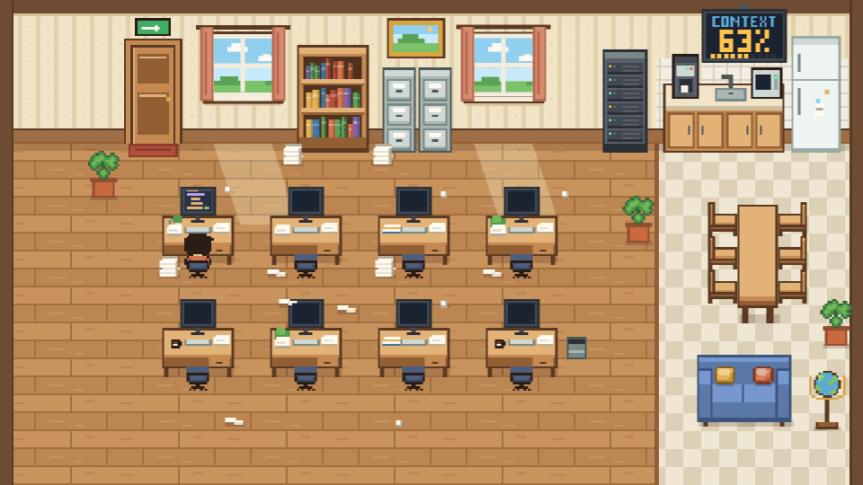

# Pixel Office

A pixel-art office behind the chat in the Claude desktop app. Claude and the subagents it starts walk around the office and act out what Claude is doing: they search the filing cabinet while it greps, read at the bookcase, work at the server rack while a shell command runs, and rest in the kitchen when the turn is over.



## What happens in the office



| When Claude is… | In the office it… |
| --- | --- |
| editing or writing files | types at its desk |
| thinking | sits at its desk under a thought bubble |
| waiting for your answer | sits at its desk under a question mark |
| searching: Grep, Glob, `rg`, `grep`, `find`, `ls` | opens the filing cabinet |
| reading: Read, a skill, `cat`, `head`, `jq` | reads at the bookcase |
| running any other shell command | works at the server rack |
| on the web: WebFetch, WebSearch, browser tools | spins the globe |
| reading or saving its memory (the auto-memory folder) | opens the fridge and looks inside; each saved memory leaves a sticky note on the freezer door |
| done with its turn | rests in the kitchen after a few seconds |

- People look like the model they run on: Opus is a sharp IT guy with swept-up hair and a short beard, Fable a bearded man with long hair and glasses, Sonnet a young developer with spiky dyed hair and headphones, Haiku a young woman with two buns. Each model has eight sets of hair and clothes colors, so five subagents on one model still look different. Claude always wears its orange shirt.
- Each subagent walks in through the door and works at a free desk, going to the same stations for its own tools. When it finishes, it rests in the kitchen for two minutes and then goes home.
- The board on the wall shows how full the context window is, measured like the app's context meter. It is green below 50%, amber from 50% and red from 80%. Paper piles up on the desks and the floor as the context fills.
- After the context is compacted, a janitor comes in and clears the paper away.
- It is day in light mode and night in dark mode.

## Install

In a Claude Code session in a terminal:

```
/plugin install pixel-office --marketplace spaut33/claude-pixel-office
```

Answer `y` to "Add marketplace?", then press Enter to install it for your user.

From a shell:

```bash
claude plugin install pixel-office --marketplace spaut33/claude-pixel-office
```

In the Claude desktop app, where `/plugin` does not run: click **+** next to the prompt box, then **Plugins**, **Add marketplace** with `spaut33/claude-pixel-office`, then **Add plugin**.

Installed for your user, the office shows up behind the chat in the desktop app's Code tab from the next session on. A terminal session has no backdrop, so there the mod draws nothing.

Built and tested with Claude Code 2.1.330.

## Privacy

The mod makes no network requests and does not read or write files. It sees the names of the tools Claude calls, the shell command line (only to tell a search or a read from other commands), the short description of each subagent's task, and how full the context is. It keeps the office in the session's state.

## Development

Clone the repository and start Claude Code with the folder as a plugin directory:

```bash
git clone https://github.com/spaut33/claude-pixel-office
claude --plugin-dir ./claude-pixel-office
```

`claude plugin validate .` checks the manifest, the marketplace file and the hooks module.
`deno test --no-check --unstable-sloppy-imports` runs the tests; CI runs both on every pull request.

| File | What it does |
| --- | --- |
| `hooks/register.tsx` | the hooks: tool calls, subagents, turns, compaction and the backdrop |
| `hooks/office/world.ts` | where each worker wants to be, and the walk there |
| `hooks/office/world.test.ts` | tests for `world.ts` |
| `hooks/office/layout.ts` | the floor plan: walkways, desks, stations and seats |
| `hooks/office/art.ts` | the pixel art: furniture, bodies and the office's colours |
| `hooks/office/casts.ts` | how people look: a head per model family and eight color sets each |
| `hooks/office/scene.ts` | puts everyone in place and draws one animated SVG |
| `hooks/office/pixel.ts` | drawing helpers |
| `types/index.d.ts` | the shape of the state the mod keeps |

## Releasing

1. Raise `version` in `.claude-plugin/plugin.json` in a pull request and merge it.
2. Tag the merged commit on `main` and push the tag: `git tag vX.Y.Z && git push origin vX.Y.Z`.
3. The `Release` workflow checks the tag against `plugin.json` and publishes a GitHub release with notes from the merged pull requests.

`main` only takes changes through pull requests, merged with rebase. Release tags can't be moved or deleted.

## License

[MIT](LICENSE)
